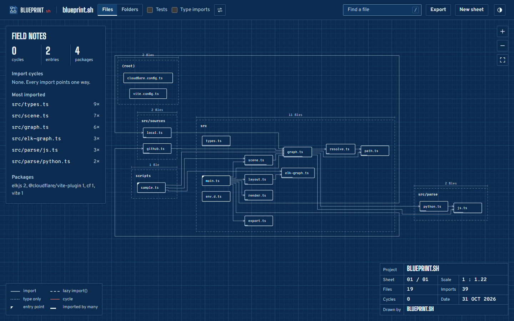
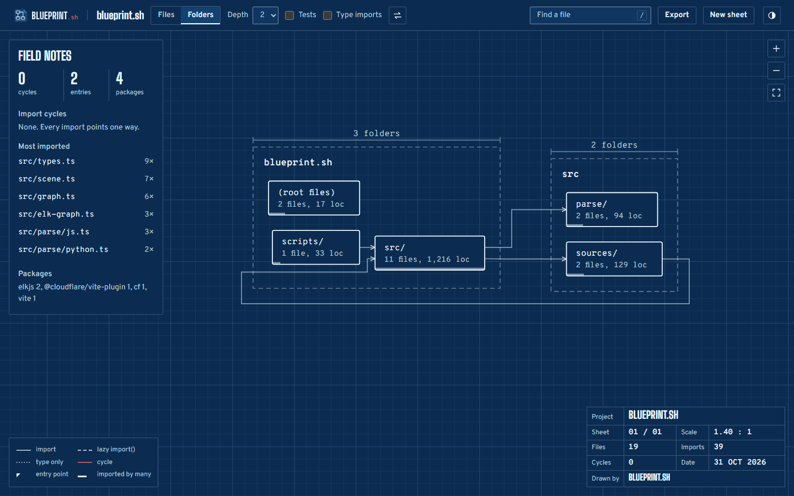
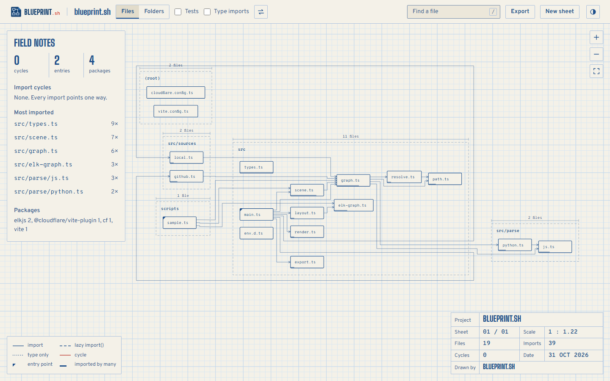

<p align="center"><picture><source media="(prefers-color-scheme: dark)" srcset="brand/wordmark-dark.svg"></picture></p>

<p align="center"><b>Drop a codebase in. Get its architecture drawn.</b><br>
JavaScript, TypeScript and Python. Parsing, layout and rendering all happen in your browser, so your code is never uploaded.</p>

<picture>
  <source media="(prefers-color-scheme: dark)" srcset="docs/readme/drafting-dark.svg">
  
</picture>

---

Architecture diagrams in docs go stale the week they are drawn. Blueprint.sh draws the real one from the imports: folders become drafting frames, modules become parts, every import becomes a routed line, and import cycles are marked in red pencil.

<p align="center"></p>

## What it does

- **Three ways in:** drag a folder onto the page, use the folder picker, or paste a public GitHub URL (fetched through the tree API and raw files, no token needed). Links like `#gh=pallets/flask` open straight to the drawing.
- **Reads imports properly.** For JS/TS that means `import`, `export … from`, `import()`, `require`, `import type`, and the `<script>` blocks of Vue/Svelte files. For Python it means `import`, `from … import`, relative imports, and submodules pulled in with `from pkg import mod`.
- **Resolves imports like the toolchain does:** `tsconfig`/`jsconfig` `paths` and `baseUrl`, Vite-style split tsconfigs, `./util.js` pointing at `util.ts`, `index` files, `@/` aliases, and Python package roots under `src/`.
- **Analyses the graph:** fan-in and fan-out, entry points, orphans, hotspots, and cycles via Tarjan's algorithm (iterative, so a 5,000-file chain can't overflow the stack). Type-only edges, including Python `if TYPE_CHECKING:` blocks, are left out of cycle detection because they never run.
- **Draws it:** ELK's layered layout with orthogonal routing runs in a worker. The renderer is hand-written SVG, with a plotter-style draw-in, pan, zoom and pinch.
- **Stays readable on big repos.** When a file-level sheet would be too small to read, it falls back to the deepest folder level that fits on one sheet. It lays out both directions when the fit is poor and keeps the better one.
- **Exports** SVG, 2× PNG, Mermaid and the full graph as JSON.

<p align="center"></p>

## Design: a drafting office

Every project gets a **title block** (project, sheet, scale, date, files, imports, cycles, drawn by). The scale is real: it tracks your zoom. Folders carry dimension lines that state their size, and lines are styled by import kind: solid for static, dashed for `import()`, dotted for type-only, red for a cycle. **Cyanotype** is white on Prussian blue. **Whiteprint** is the diazo copy, blue ink on cream stock. Type is Big Shoulders Display for lettering, Overpass for the interface and Overpass Mono for paths.

<p align="center"></p>

## Run it

```bash
npm install
npm run dev        # snapshots this repo as the built-in sample, then starts Vite
npm test           # parsers, resolver, graph metrics, GitHub source (node:test, native TS)
npm run build      # sample + typecheck + production build into .cloudflare/output/v0/
npm run deploy     # the same build, shipped as a Cloudflare Worker with static assets
```

Requires Node 22.18 or newer, because the tests run TypeScript directly. Deploying needs a Cloudflare login once: `npx cf auth login`. The site is static, so `.cloudflare/output/v0/workers/default/assets/` also works on any static host.

## Layout

```
src/parse/js.ts, python.ts   specifier extraction that ignores comments, strings and docstrings
src/resolve.ts               specifier → file | package | built-in
src/graph.ts                 graph, metrics, Tarjan SCC, folder aggregation
src/scene.ts                 what to draw (files or folders, filters)
src/layout.ts                ELK in a worker
src/render.ts                the drafting renderer + viewport
src/sources/                 drop, picker, GitHub
src/export.ts                SVG, PNG, Mermaid, JSON
```

## Limits

- Imports are found by scanning, not a full parser. Exotic cases, such as computed `require` paths or imports assembled from template strings, are skipped and listed under *Unresolved*.
- GitHub loads are capped at 1,500 source files and use the anonymous API, which allows 60 requests an hour; each repo costs 1–2 of them. Drop the folder in for anything bigger.

MIT © 2026 Shailesh Upadhyay
